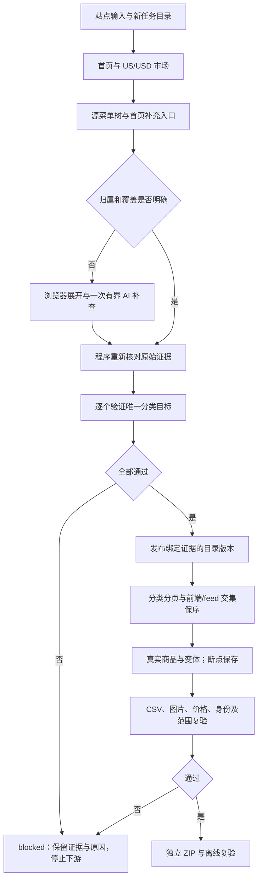

# 全自动 Shopify 采集框架

这份文档定义当前实现的功能、自动决策边界和验收方式。目标是无人值守运行、证据可追溯、错误不扩散；不承诺任意站点永不失败，也不通过删掉失败案例来提高通过率。

## 一、任务入口与运行模式

| 模块 | 功能 | 当前入口 |
| --- | --- | --- |
| 站点任务 | 独立目录、状态事件、错误记录、网页/API/CLI | `app.py` |
| 基础验收 | 审核全部目录目标，采集所选分类完整列表及前三个商品 | 默认模式 |
| 全自动全量 | 全部分类列表、商品按 ID 去重、真实变体、校验、ZIP；无人工确认 | `--full` 或网页“全自动采集全部商品” |
| 指定范围 | 使用当前真实目录中的键或 URL；不允许任意替换范围 | `--category` |
| 断点续采 | 商品记录按目录版本及列表指纹绑定；已完成记录可复用 | 独立包内 `3.ShopifyCrawl_sort.py --all` |
| 案例发现 | 只读旧项目 `url.json`，提取域名和来源；不执行旧脚本 | `tests/shopify_acceptance.py` |

全量与手动模式互斥。默认基础验收和全量验收在报告中明确区分，不用三商品样本冒充整站采集。

## 二、自动流水线



## 三、目录层是核心契约

### 1. 原始树与最终 JSON 分离

- 原始标题按数组保存，逗号只在输出时作为层级分隔符。
- 每个菜单条目保存主控件、所属面板、源链接节点及标题来源。
- 结构父节点可以没有 URL，不为凑齐层级给栏目填 `/collections/all`。
- 同一 URL 在不同真实分组下可重复，不能全局去重导致归属丢失。
- 主导航和首页补充入口分别处理；不把 sitemap 或搜索推荐批量并入目录。
- 普通菜单、ARIA 外置面板、`details/summary`、直接包装控件和明确关联的共享抽屉有程序解析支持。
- 共享抽屉还需桌面浏览器确认入口可见、子面板可操作、候选链接实际可见。
- 徽章、辅助描述、图标与明确标题分离；没有独立标题的图片链接只可借用同 URL 的真实菜单标题。

### 2. 候选不等于批准

`category_candidate.json` 是候选。只有结构检查和全部目标检查通过，才发布 `url.json` 及 `navigation_release.json`。

目标检查区分：

| 类型 | 放行条件 |
| --- | --- |
| 商品集合 | URL 保持同域同路径；集合 feed 合法；前端有商品列表，必要时渲染浏览器 |
| 空集合 | feed 为空且前端存在明确空状态 |
| 集合落地页 | 页面明确链接子集合、子集合 feed 分页完整且覆盖页面商品；或页面为有限、无动态分页的显式商品卡片集合，每张卡片均由真实商品接口确认身份；两类来源分别存档，不伪造集合 feed |
| 筛选/锚点集合 | 保留语义参数；进一步验证实际列表范围，不扩大为整个集合 |
| 非分类页 | 账户、奖励、推荐好友、搜索、文章、政策、`/pages/`、`/products/` 等排除 |
| 未知/矛盾/失效 | 自动停止并记录，不能生成合格版本 |

集合索引 `/collections` 本身不是商品集合，只保留其分组结构及可采集子链接。

### 3. AI 的权限与边界

- 证据完整、疑点为空时不调用 AI。
- 有疑点时一次有界补查；AI 无权直接宣布发布。
- 未受影响的确认项保持不变。发现实证矛盾可在 `reopened_confirmed` 记录键、理由和来源。
- 程序必须独立重建受影响根目录并与修正结果一致，否则停止。
- 局部补查只要求覆盖受影响、新增和重开的根目录，不再强制重新审查全部已确认分支。
- 新增/改名 URL 必须存在于声明的原始页面，来源文件必须位于任务证据目录。

### 4. 目录版本与防绕过

`navigation_release.json` 记录 `checking / blocked / approved` 状态及目录版本。版本绑定最终 JSON、菜单证据、首页快照、目标审核记录和目标响应。

平台、独立列表脚本、独立商品脚本和离线校验器都检查版本。任何被绑定的输入变化，都必须重新审核。`detail_release.json` 继续把商品链接绑定到同一目录版本，防止修改目录后复用旧分类归属。

这些指纹用于发现文件变化和版本错配，不是用于证明网络内容永远不变，也不是面向恶意篡改整个运行环境的数字签名。

## 四、商品层

- Shopify 类型与 US/USD 市场检查。
- 分类 feed 提供成员身份，前端实际商品区域提供顺序；分页循环、重复页、筛选参数丢失均报错。
- 集合落地页使用明确子集合成员的并集与本页展示商品交集；不把全站商品当作成员集合。
- 动态列表走浏览器；未知加载更多不能按首屏宣称完整。
- 真实变体逐行导出，不组合笛卡尔积、不伪造库存、价格或图片归属。
- JSON 金额和 Ajax `.js` 美分明确区分。
- 250 变体截断风险仍阻止通过，等待具备完整证据的适配。
- 全量商品按绑定版本保存断点；结束后校验全部商品，失败不生成新的成功包。

## 五、运行与产物

```powershell
# 基础单站
python app.py --site https://www.k18hair.com --out runs/k18-basic

# 全自动全量；可指定真实菜单分类限制范围
python app.py --site https://www.k18hair.com --full --out runs/k18-full

# 从旧项目发现并测试选定案例
python tests/shopify_acceptance.py --work D:/pythonProject/work --sites k18hair.com jonesroadbeauty.com lolablankets.com explodingkittens.com

# 指定案例全量验收
python tests/shopify_acceptance.py --sites k18hair.com --full

# 离线测试
python -m unittest discover -s tests
```

每次在线验收使用新目录，保留失败尝试。`summary.json` 明确计划数量、完成数量、每站结果及采集范围。旧项目 JSON 仅用于选取测试域名，不作为当前网站菜单的正确答案。

主要产物：`url.json`、`navigation_release.json`、`navigation_targets.json`、`detail_url.json`、`detail_release.json`、`sample_scope.json`、原始证据、`samples.json`、三种 CSV、`validation.json`、`report.json`、`crawler.zip`。失败记录在 `failure.json` 和对应阶段报告。

## 六、验收标准与边界

1. 离线测试覆盖错误归属、漏项、无来源、非分类链接、版本错配、目标无效、落地页成员不完整、独立脚本绕过等负例。
2. 已知失败页面回放检查解析回归；回放不能冒充在线成功。
3. 在线基础验收覆盖完整目录目标、完整选定分类列表和三个商品的全部真实变体。
4. 至少一个小型站点执行全目录全量详情，并复验独立包。
5. 网络拒绝、限流、空壳组件和不支持的分页均明确列为失败/阻塞；不能删项、改 URL 或降低校验换取通过。

当前重点是 Shopify 公共主题站点。非 Shopify、受保护的私有接口、特殊跨商品变体合并、未知筛选和动态组件需要独立适配。站点可用性受网络与网站变更影响；“无人值守”意味着自动执行和自动判定结果，不意味着对不具备证据的站点假报成功。

具体测试数据以本次验收报告为准，功能文档不代替实测结果。
